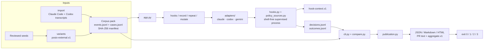

# charter-replay

<p align="center"></p>

Replay a pinned command corpus through two PreToolUse hooks and fail the gate when the candidate silently allows what the baseline blocked.

[](https://github.com/Chris0Jeky/charter-replay/actions/workflows/ci.yml)
[](https://github.com/Chris0Jeky/charter-replay/actions/workflows/action-selftest.yml)
[](https://github.com/Chris0Jeky/charter-replay/actions/workflows/review-acceptance.yml)
[](LICENSE)
[](pyproject.toml)


## What it is

Coding-agent hooks decide whether a command may proceed. Change one rule, one regex, one `--help` exemption, and a deny becomes an allow. The runtime will not tell you. charter-replay will.

It is a **decision-replay harness**. It feeds recorded command events to a baseline hook and a candidate hook the way Claude Code, Codex, or Gemini CLI would: shell-free argv, the runtime's hook JSON on stdin (`PreToolUse` for Claude Code and Codex, `BeforeTool` for Gemini CLI), a fresh workspace as cwd. Then it diffs the effects — allow, deny, indeterminate — by event id, case class and family, and exits 1 when a class you named appears (default: newly allowed or newly indeterminate).

It is not a live interceptor, a policy language, a sandbox, a safety proof, or a benchmark. The runner never executes corpus command strings. It executes the hook you pointed at, with your privileges. Reports describe decision changes. They never claim that an original command was safe, unsafe, executed, or reproduced.

Review a guard change the same way as any other control: pin the inputs, run both sides, publish a diff you can argue with. The kernel is exact-byte and fail-closed. The adapters are documentation-derived models, not certifications against a running binary.

## Features

- **`hooks`** — record two PreToolUse command hooks over one captured corpus and compare them through the kernel. Default gate: `newly-allowed`, `newly-indeterminate`.
- **`record`** — run one hook and write a recorded decision source (`recorded:<path>`) the kernel `replay` command accepts.
- **`replay` / `validate`** — the replay v0 kernel: compare two decision streams (recorded files or `process:` / `process-json:` programs) over a SHA-256-bound corpus.
- **`repeat`** — record one hook 2–50 times and classify each event as `stable`, `reason-varies`, `outcome-varies`, or `effect-varies`, keyed by hook-context id.
- **`mutate`** — bounded toy-hook mutation sensitivity: explicit `mutation-plan.v1`, two healthy baseline passes, killed / survived / invalid / timeout accounting. Corpus sensitivity, not a security proof.
- **`variants`** — derive or byte-verify a bounded POSIX variant pack (`posix-external.v1`). Generates strings only; never a shell, a hook, or a network call.
- **`import`** — build a private corpus from local Claude Code and Codex transcripts, with credential and identity scrubbing. Output stays private even after scrubbing; never commit it.
- **`aggregate`** — rebuild verified counts-only `aggregate.v1` (no event ids, commands, reasons, paths). `hooks` already writes it; a leak check refuses the file rather than publish free text.
- **Runtime adapters** — built-in registry, no plugin loader: `claude` (`claude-pretooluse.v1`), `codex` (`codex-pretooluse.v1`), `codex-legacy` (`codex-legacy-floor.v1`), `gemini` (`gemini-beforetool.v1`). See [runtime contracts](docs/RUNTIME_CONTRACTS.md).
- **Reports** — transactional `report.json`, `report.md`, standalone `report.html` (no external assets; readable with JavaScript off), bounded `pr-comment.md` / `pr-comment-aggregate.md`, plus hook `summary.json` / `summary.md`.
- **Least-privilege Action** — composite `action.yml` runs `hooks` in the caller's job: no token permissions, no upload, no comment. Pin by commit SHA to pin the tool revision. [docs/ACTION.md](docs/ACTION.md).
- **Zero runtime dependencies.** Python 3.11+ on Linux, macOS and Windows. CI covers 3.11 and 3.13 on all three, plus Windows 3.14.

## Architecture

The compare layer does not inspect command grammar or runtime names. The adapter owns payload construction and reply classification. The invocation layer owns subprocesses, timeout cleanup, environment and cwd. Renderers consume one result model and never run a hook.



Module map: [docs/CODEBASE_MAP.md](docs/CODEBASE_MAP.md). Proposed direction (not a claim that every heading is shipped): [docs/ARCHITECTURE.md](docs/ARCHITECTURE.md).

## Quick start

Python 3.11+ on `PATH`. From a checkout:

```bash
python -m pip install .
```

Published wheel and source archives, verification and rollback: [docs/RELEASING.md](docs/RELEASING.md). The optional PyPI job in [`.github/workflows/release.yml`](.github/workflows/release.yml) runs only when the owner has registered a trusted publisher and set `PYPI_TRUSTED_PUBLISHER=true`; a skipped job means GitHub release assets only.

Validate the bundled charter (50 events, exact-byte manifest):

```bash
charter-replay validate --corpus charter_replay/corpora/charter
```

Replay the checked-in toy guards. Version 2 exempts `--help` and dry runs, and it drops `git clean` from its deny list. The default gate fails:

```bash
charter-replay hooks \
  --baseline "python examples/toy-guard/guard_v1.py" \
  --candidate "python examples/toy-guard/guard_v2.py" \
  --corpus charter_replay/corpora/charter \
  --output reports/demo
```

This is the command [CI](.github/workflows/ci.yml) installs and runs. It exits **1**. `summary.json` reports `newly-allowed: 4`, `newly-denied: 1`, `unchanged: 45`. Checked-in copy of that result: [examples/toy-guard/report/summary.md](examples/toy-guard/report/summary.md). The hook argv's first word is the interpreter on `PATH`; CI provides `python`, a host that only has `python3` should use that.

> This re-evaluates recorded command events and decisions. It does not reproduce the original agent, environment, shell effects, or operating-system boundary.

Each hook runs once per command, as the runtime runs it: shell-free argv, the runtime's hook JSON on stdin (`BeforeTool` under `--runtime gemini`), `cwd` inside a fresh workspace (optionally copied from `--workspace`), and `CLAUDE_PROJECT_DIR` set to that workspace (not under `--runtime codex`). A hook command is a JSON array or POSIX-quoted words. On Windows, `py -3` works as the interpreter and forward slashes avoid quoting trouble.

Open `reports/demo/report/report.html` in a browser for the offline review view. For a pull request, use the Action:

```yaml
- uses: actions/checkout@<sha>   # the hook paths below live in your repository
  with:
    persist-credentials: false
- uses: Chris0Jeky/charter-replay@<sha>
  with:
    baseline: python hooks/guard_main.py
    candidate: python hooks/guard.py
```

Never `pull_request_target`. Untrusted candidates replay only public synthetic corpora; a report produced in the same job as an untrusted hook is evidence of that job's claims only. Details and inputs: [docs/ACTION.md](docs/ACTION.md).

For a private corpus, publish only the verified counts-only `aggregate.v1` (`hooks` writes it; rebuild with `charter-replay aggregate`; Action input `summary-mode: aggregate`): [docs/AGGREGATE.md](docs/AGGREGATE.md).

### Mutation and kernel replay

```bash
charter-replay mutate \
  --plan examples/toy-guard/mutation-plan.json \
  --corpus charter_replay/corpora/charter \
  --output reports/mutation
```

Expected on the toy plan: one killed mutant, one survivor, score 1/2, exit 1. Limits and denominator: [docs/MUTATION-SENSITIVITY.md](docs/MUTATION-SENSITIVITY.md).

Kernel comparison of already-recorded decisions (no hook runs):

```bash
charter-replay replay \
  --baseline recorded:examples/toy-guard/report/baseline/decisions.jsonl \
  --candidate recorded:examples/toy-guard/report/candidate/decisions.jsonl \
  --corpus charter_replay/corpora/charter \
  --output reports/toy-guard-recorded
```

`python -m charter_replay.app` is the same entry as the `charter-replay` console script. `python -m charter_replay.cli` is the kernel only (`replay`, `validate`).

## Commands

| Command | What it does |
|---|---|
| `hooks` | Record baseline and candidate hooks, compare, write summary + aggregate + report |
| `record` | Record one hook as a `recorded:` source |
| `replay` | Compare two sources over a corpus (kernel) |
| `validate` | Admit a corpus manifest and its exact-byte files |
| `repeat` | Measure one hook's variation over N recordings |
| `mutate` | Evaluate an explicit toy mutation plan |
| `variants generate \| verify \| coverage \| review` | Bounded POSIX packs and capture-bound review |
| `import` | Private corpus from local transcripts |
| `aggregate` | Rebuild `aggregate.v1` from a report directory |

Exit codes are shared: **0** configured gate passed, **1** a named change class is present, **2** invalid input or broken exact-byte binding, **3** hook/source/output failure after a comparison can be formed. Exit 3 beats exit 1. Both sides are admitted before either hook runs. [docs/HOOK_EXECUTION.md](docs/HOOK_EXECUTION.md).

## Hook replies

| hook reply | outcome | replay effect |
|---|---|---|
| exit 2 (stderr is the reason) | deny | deny |
| exit 0, no output, or JSON with no decision | allow | allow |
| `permissionDecision` allow / deny | allow / deny | allow / deny |
| `permissionDecision` ask | ask | `--ask-as` (default deny) |
| legacy `decision` approve / block | allow / deny | allow / deny |
| `continue: false` | stop | deny |
| any other exit code | crash | indeterminate |
| exit 0 with unreadable output | invalid-output | indeterminate |
| no reply within `--hook-timeout` | timeout | indeterminate |
| executable cannot start | start-failed | indeterminate |
| more than `--hook-output-limit` bytes (default 1 MiB) on stdout or stderr | output-limit | indeterminate |

`--hook-output-limit` is 1024–67108864 bytes per stream. Overflow kills the hook's process family, is a `hook-output-limit` source failure (exit 3), and the reason names the stream and the limit, never the output.

`--runtime codex` is `codex-pretooluse.v1`, modelled on Codex hooks documentation (not certified against a running Codex). Unsupported replies (`ask`, legacy `approve`, `continue: false`, `stopReason`, `suppressOutput`), malformed JSON, an `allow` without the rewrite Codex requires, and exit 2 without a stderr reason are `invalid-output`. `--ask-as` has no effect. No `CLAUDE_PROJECT_DIR`. `--runtime codex-legacy` keeps the v0.1 floor so old recordings reproduce; it is not fail-safe.

`--runtime gemini` is `gemini-beforetool.v1`, modelled on Gemini CLI hooks documentation and upstream source (not certified against a running Gemini CLI). `decision` deny/block and exit 2 deny; `continue: false` is `stop`; other exits, non-JSON stdout, input rewrites and `ask` are indeterminate.

Reply table and sources: [docs/RUNTIME_CONTRACTS.md](docs/RUNTIME_CONTRACTS.md). Each recording writes `hook-context.json`, an input-only identity for what the hook was given — a consistency key, not execution authentication: [docs/HOOK-CONTEXT.md](docs/HOOK-CONTEXT.md).

## Corpora

The runner never executes these command strings. Classification comes only from validated baseline and candidate `PolicyDecision` effects keyed by `event_id`.

| pack | events | what it is |
|---|---:|---|
| [`charter_replay/corpora/charter`](charter_replay/corpora/charter/corpus-manifest.json) | 50 | 20 synthetic dangerous, 20 synthetic benign, 10 historical/opaque shapes. Inert strings. |
| [`charter_replay/corpora/charter-v0.2`](charter_replay/corpora/charter-v0.2/corpus-manifest.json) | 494 | v0.1 prefix unchanged, then more synthetic cases (297 dangerous, 187 benign, 10 opaque). |
| [`examples/packs/charter-posix-v1.json`](examples/packs/charter-posix-v1.json) | recipe | 50 seeds, 54 derived, 96 skipped under `posix-external.v1`. |

v1 case metadata cannot prove independent labeling. Metrics say "agreement with supplied v1 labels", not "safety accuracy": [docs/METRICS.md](docs/METRICS.md).

`charter-replay import` builds a private corpus from local Claude Code and
Codex transcripts. It scrubs credentials, home paths, the local user, host and
Git identity, email addresses, private hosts and repository names, and it
refuses to write inside a Git work tree unless Git ignores the target. Scrubbing is
pattern-based defence in depth: it also rescans percent-encoded and
quote-concatenated words (up to two percent-decoding layers), but it cannot
recognise every credential format or parse arbitrary shell syntax. Lines longer
than 4,096 characters are replaced in full with `<redacted>` before pattern
matching to bound regex work; their line endings and neighbouring lines survive.
The output is private even after scrubbing: never commit it. Import requires a new
output directory; existing directories, files and links are never overwritten.
On POSIX, the corpus directory and files are created with modes `0700` and
`0600` (or stricter under the umask), and group/other access is rejected before
publication. Missing parents are created with mode `0700`. Use a parent
directory you control. On Windows, POSIX mode bits do not prove privacy: the
parent ACL must restrict access to the intended account and trusted
administrators. The importer does not audit Windows ACLs.

## Kernel process sources

`replay` accepts `recorded:<path>`, `process:executable,arg,policy-file`, or `process-json:<JSON-array>`. Commas in `process:` are separators; quotes and backslashes have no escaping meaning. Use `process-json:` when a value contains a comma: exactly one JSON array of strings, first the executable, last the policy file.

Process identity is `process-policy-identity.v9`: executable basename and resolved target bytes/mode, entry-policy bytes, the policy-parent tree, timeout, fixed environment, POSIX `0700` runner-owned directory modes, an opaque SHA-256 of the resolved snapshot parent, and a fixed snapshot mtime of `946684800000000000` ns (2000-01-01T00:00:00Z). Immediately before each process runs, the runner copies the bound tree into a private snapshot, verifies it, and launches only from the snapshot paths.

The snapshot is reproducibility containment, not an operating-system sandbox. A hostile process running as the same OS user may still discover or rewrite temporary storage. Policy behaviour after process start remains outside the snapshot guarantee. On Windows an event-gated supervisor enters a kill-on-close Job Object. On POSIX the policy root starts in a new session and root process group; descendants that `setsid` / `setpgid` leave v0 containment. Process-source output has no byte quota (hook recording does). Overlapping evaluations of the same identity are not serialized. Recognized Windows CPython virtualenv launchers are rejected at admission (exit 2); use a native interpreter.

Despite its compatibility filename, [`charter_replay/fixtures/legacy-decisions.jsonl`](charter_replay/fixtures/legacy-decisions.jsonl) is a synthetic freeze-candidate expectation for the curated charter. It was not captured by executing a private legacy dispatcher. The reference candidate maps the 50 reviewed fixture event IDs to expected effects; it does not parse command text.

## Limits

- Hooks and `process:` policies are unsandboxed programs. Run only code you trust; isolate them yourself if you need containment.
- Runtime adapters are documentation-derived. None is certified against a running Claude, Codex, or Gemini binary.
- A same-job report next to an untrusted hook is not a trusted artifact. Do not point a fork candidate at a private corpus.
- `aggregate.v1` omits free text; small counts can still disclose information. It is not differential privacy.
- Process identities are host-context evidence, not portable cross-host correlation keys.
- Reports never claim an original command was safe.

Security boundary and reporting: [SECURITY.md](SECURITY.md).

## Tech stack

| Piece | What is actually there |
|---|---|
| Language | Python 3.11+, stdlib only at runtime (`requires-python = ">=3.11"`, `dependencies = []`) |
| Packaging | setuptools ≥77, console script `charter-replay = charter_replay.app:main` |
| Dev extras | `black==26.3.1`, `ruff==0.15.13` |
| Schemas | `command-event.v1`, `policy-decision.v1`, `charter-case.v1`, `mutation-plan.v1`, `hook-context.v1`, `aggregate.v1` |
| CI | [ci.yml](.github/workflows/ci.yml) unittest + README example + lint + wheel hygiene; [action-selftest.yml](.github/workflows/action-selftest.yml) three-OS `uses: ./`; [review-acceptance.yml](.github/workflows/review-acceptance.yml) Playwright HTML + isolated wheel; [release.yml](.github/workflows/release.yml) GitHub assets |
| Action | composite `action.yml`, install from checkout, no token |

## Status and roadmap

**0.1.1**, Development Status :: 3 - Alpha. Package version stays here until the maintainer cuts a release. Changelog: [CHANGELOG.md](CHANGELOG.md).

Shipped on `main` (roadmap ids, evidence is the linked PR): runtime adapter registry (R02-1), failure admission (R02-2), per-event workspaces (R02-3), label agreement and observational latency (R02-4), HTML / PR text and verified variant review (R02-5), bounded POSIX variants (R02-6), least-privilege Action (R03-1), `aggregate.v1` (R03-2), `codex-pretooluse.v1` (R03-3), `gemini-beforetool.v1` (R03-4), `hook-context.v1` first increment (R04-1), repeat stability (R04-3), bounded mutation sensitivity (R05-3), per-stream output limit first increment (R08-2).

Still planned, not shipped: split `policy_sources.py` (R04-2, deferred [#43](https://github.com/Chris0Jeky/charter-replay/issues/43)); independent case-evidence and a human-reviewed seed benchmark (R05-1, R05-2); `action-event.v1` for file / network / MCP (R06); digest-verified pack install and private aggregate trends (R07); reviewed Windows transforms (R08-1); remaining output/disk budget work (R08-2). Delivery order: [docs/ROADMAP.md](docs/ROADMAP.md).

Tracked platform issues: intermittent macOS `start-failed` under synthetic overflow ([#49](https://github.com/Chris0Jeky/charter-replay/issues/49)); Windows descendant-cleanup elapsed assertion on a loaded host ([#52](https://github.com/Chris0Jeky/charter-replay/issues/52)).

## Contributing

- Open an issue first for anything beyond a small fix.
- One purpose per pull request. Synthetic fixtures only.
- Stay inside decision replay: no live interception, no policy language, no new decision effects.
- Never include real secrets, private commands, malware, or instructions for bypassing someone else's controls.

```bash
python -m unittest discover -s charter_replay/tests -v
python -m ruff check charter_replay examples
python -m black --check charter_replay examples
```

Full rules: [CONTRIBUTING.md](CONTRIBUTING.md).

## Links

| | |
|---|---|
| Architecture | [docs/ARCHITECTURE.md](docs/ARCHITECTURE.md) · [docs/CODEBASE_MAP.md](docs/CODEBASE_MAP.md) |
| Runtime contracts | [docs/RUNTIME_CONTRACTS.md](docs/RUNTIME_CONTRACTS.md) |
| Hook execution / context | [docs/HOOK_EXECUTION.md](docs/HOOK_EXECUTION.md) · [docs/HOOK-CONTEXT.md](docs/HOOK-CONTEXT.md) |
| Reports / aggregate / Action | [docs/REVIEW_REPORTS.md](docs/REVIEW_REPORTS.md) · [docs/AGGREGATE.md](docs/AGGREGATE.md) · [docs/ACTION.md](docs/ACTION.md) |
| Variants / mutation / repeat | [docs/VARIANTS.md](docs/VARIANTS.md) · [docs/MUTATION-SENSITIVITY.md](docs/MUTATION-SENSITIVITY.md) · [docs/REPEAT-STABILITY.md](docs/REPEAT-STABILITY.md) |
| Roadmap / releasing | [docs/ROADMAP.md](docs/ROADMAP.md) · [docs/RELEASING.md](docs/RELEASING.md) · [CHANGELOG.md](CHANGELOG.md) |
| Security / contributing / license | [SECURITY.md](SECURITY.md) · [CONTRIBUTING.md](CONTRIBUTING.md) · [LICENSE](LICENSE) |
| Issues | [github.com/Chris0Jeky/charter-replay/issues](https://github.com/Chris0Jeky/charter-replay/issues) |
| Toy example | [examples/toy-guard/README.md](examples/toy-guard/README.md) |

Apache License 2.0. Only the latest 0.x release receives fixes. Report vulnerabilities via GitHub private vulnerability reporting, not a public issue.
